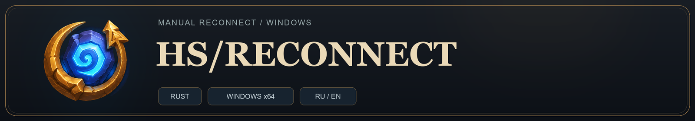

# HS/RECONNECT

[Русский](README.md) | **English**

**A lightweight native application for Hearthstone with a separate in-game overlay.**

**Windows 10/11 x64 · Rust**

> Unofficial application. It is not affiliated with or endorsed by Blizzard Entertainment.

## Features

- **Manual reconnection** from the main window or the in-game overlay.
- **Separate overlay** displayed over the active Hearthstone window.
- **Easy customization:** repositioning, size adjustment, and position locking.
- **Russian and English interface:** quick switching between application languages.
- **System tray support:** closing the main window does not exit the application.
- **Optional startup with Windows** after the user signs in.
- Saves language, scale, position, and other interface settings.

## How it works

The application identifies the `Hearthstone.exe` process, obtains the match server address from local game logs, and matches it to an established TCP connection belonging to that process.

After a **manual click**, it requests a reset of the selected connection using the Windows IP Helper API — `SetTcpEntry` with `DELETE_TCB`. The game itself handles the subsequent reconnection.

If the connection cannot be uniquely identified or changes before the reset, the action is cancelled. There are no automatic repeated resets.

The application:

- does not inject code or DLLs into the game;
- does not use game hooks or drivers;
- does not read or modify the game process's memory;
- does not modify game files or firewall rules;
- does not control gameplay actions.

> Reconnecting intentionally interrupts the connection to the match. It may not help with server or internet issues and does not guarantee a successful return to the match.

## Requirements

- Windows 10 or Windows 11, **x64**.
- Administrator privileges, required to reset the TCP connection.
- Hearthstone in **windowed or borderless mode** for the overlay to work. Exclusive fullscreen mode is not supported.
- Available game logs containing the current match server address.

## Quick start

1. Download the latest release. Launch the application and Hearthstone.
2. Enter a match and wait for the **`Connected`** status.
3. Click **`RECONNECT`** when needed.
4. Wait for the game to reconnect.

## Troubleshooting

**Endless reconnection**

Do not reconnect during the minion recruitment phase if you are at risk of being kicked from the game.

**Windows startup produces an error**

Check the error message and whether Task Scheduler is available. Organizational policies may prevent task creation; do not disable Windows security to bypass these restrictions.

**Does the application guarantee that my account will not be banned?**

No. Blizzard determines whether third-party tools are permitted. Review the current game rules yourself before using the application.

## AI assistance

This application was developed with GPT-6.1 Sol

## License

The code is distributed under the [MIT](LICENSE) license.

Hearthstone and related names belong to their respective rights holders. The game's name is used to describe compatibility; this project is not an official Blizzard product.
