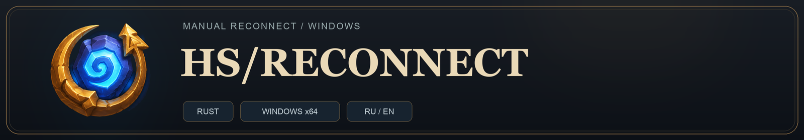

# HS/RECONNECT

**Русский** | [English](README.en.md)

**Нативное легковесное приложение для Hearthstone с отдельным игровым оверлеем.**

**Windows 10/11 x64 · Rust**

> Неофициальное приложение. Никак не связано с Blizzard Entertainment и не одобрено компанией.

## Возможности

- **Ручное переподключение** в главном окне или в игровом оверлее.
- **Отдельный оверлей** поверх активного окна Hearthstone.
- **Удобная кастомизация:** перемещение, регулятор размера, фиксация положения.
- **Русский и английский интерфейс:** быстрое переключение языка приложения.
- **Работа в трее:** закрытие главного окна не завершает приложение.
- **Опциональный запуск с Windows** после входа пользователя в систему.
- Сохранение языка, масштаба, положения и остальных настроек интерфейса.

## Как работает приложение

Программа определяет процесс `Hearthstone.exe`, получает адрес матча из локальных логов игры и сопоставляет его с установленным TCP-соединением этого процесса.

После **ручного нажатия** она запрашивает сброс выбранного соединения через Windows IP Helper API — `SetTcpEntry` с `DELETE_TCB`. Дальнейшее переподключение выполняет сама игра.

Если соединение не удалось однозначно определить или оно изменилось перед сбросом, действие отменяется. Автоматических повторных сбросов нет.

Приложение:

- не внедряет код или DLL в игру;
- не использует игровые хуки и драйверы;
- не читает и не изменяет память игрового процесса;
- не изменяет файлы игры и правила брандмауэра;
- не управляет игровыми действиями.

> Реконнект намеренно обрывает соединение с матчем. Он может не помочь при проблемах сервера или интернета и не гарантирует успешного возврата в матч.

## Требования

- Windows 10 или Windows 11, **x64**.
- Права администратора, необходимые для сброса TCP-соединения.
- Hearthstone в **оконном или безрамочном режиме** для работы оверлея. Эксклюзивный полноэкранный режим не поддерживается.
- Доступные логи игры с адресом текущего матча.

## Быстрый старт

1. Скачайте последний релиз. Запустите программу и Hearthstone.
2. Войдите в матч и дождитесь статуса **`Подключено`**.
3. При необходимости нажмите **`RECONNECT`**.
4. Дождитесь переподключения со стороны игры.

## Возможные проблемы

**Бесконечное переподключение**

Не выполняйте переподключение во время фазы покупки существ, если вас могут кикнуть с игры.

**Автозапуск выдаёт ошибку**

Проверьте текст сообщения и доступность Планировщика заданий. Корпоративные политики могут запрещать создание заданий; не отключайте защиту Windows для обхода ограничений.

**Гарантирует ли приложение отсутствие блокировки аккаунта?**

Нет. Решения о допустимости сторонних инструментов принимает Blizzard. Перед использованием самостоятельно ознакомьтесь с актуальными правилами игры.

## Использование AI

Приложение разработано с помощью GPT-6.1 Sol

## Лицензия

Код распространяется по лицензии [MIT](LICENSE).

Hearthstone и связанные обозначения принадлежат соответствующим правообладателям. Название игры используется для описания совместимости; проект не является официальным продуктом Blizzard.
